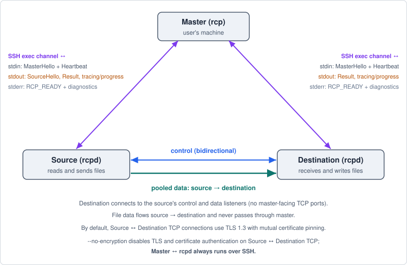

# Remote Copy Operations

This document covers the operational aspects of rcp's remote copy functionality: binary discovery,
version checking, automatic deployment, and network connectivity.

Start with [network connectivity](#network-connectivity) for connection failures, or the
[CLI reference](#cli-reference) for configuration. For implementation work, use the
[remote component design](../remote/DESIGN.md) as a reader map and the
[protocol reference](remote_protocol.md) for message types, flows, and invariants. Repository-wide
[testing](testing.md) and [benchmarking](benchmarking.md) guidance lives separately.

## Overview

The rcp remote copy system uses a three-node architecture:



**Key components**:

- **Master (rcp)**: Coordinates the operation, runs on user's machine
- **Source (rcpd)**: Reads and sends files
- **Destination (rcpd)**: Receives and writes files

The master connects to remote hosts via SSH, spawns rcpd processes, and coordinates the transfer.
All TCP connections (Master↔rcpd and Source↔Destination) are encrypted with TLS by default.

Keep remote source and destination trees disjoint, including on the same host: remote copies have no
[overlap check](tocttou.md#remote-sourcedestination-overlap) and can copy their own output
recursively.

## TLS Encryption

By default, all TCP connections are encrypted using TLS 1.3 with self-signed certificates and
fingerprint pinning.

### Security Properties

| Connection           | Authentication                                 | Encryption |
| -------------------- | ---------------------------------------------- | ---------- |
| Master → rcpd        | Mutual fingerprint pinning (exchanged via SSH) | TLS 1.3    |
| Source ↔ Destination | Mutual fingerprint pinning (via Master)        | TLS 1.3    |

**Key features**:

- **Forward secrecy**: Ephemeral keys per session
- **Mutual authentication**: Both parties verify each other's certificates
- **No trust anchor**: Self-signed certificates with fingerprint pinning (no CA)
- **Transparent**: No configuration needed (enabled by default)

### Connection Flow

1. **Master prepares compatible rcpd endpoints**, sharing one SSH preparation for a same-host copy
2. **Master spawns source rcpd via SSH**: `ssh host "rcpd --role source --master-cert-fp <fp>"`
3. **Source generates an ephemeral certificate** and reports its fingerprint plus negotiated file
   and stream limits in the first stderr readiness record
4. **Master connects to the source before spawning the destination**, then starts the destination
   with the source-negotiated limits and verifies its readiness record matches
5. **Master connects with TLS**, verifying each rcpd's certificate fingerprint; rcpd in turn
   verifies master's client certificate against `--master-cert-fp`
6. **Master distributes fingerprints** to source and destination for mutual TLS

### Disabling Encryption

For performance on fully trusted networks, encryption can be disabled:

```bash
rcp --no-encryption source:/path dest:/path
```

**WARNING**: This disables both encryption and certificate authentication on all rcp TCP
connections, including control and tracing, not just file data. SSH does not protect these direct
TCP connections. Only use on trusted, isolated networks.

For more details on the security model, see [security.md](security.md).

## rcpd Binary Discovery

When initiating a remote copy, rcp must locate the rcpd binary on remote hosts.

### Search Strategy

Discovery checks locations in this order:

1. **Explicit path** (`--rcpd-path` flag)
   - Highest priority, user override
   - Checked via SSH: `test -x /path/to/rcpd`

2. **Same directory as local rcp**
   - Most likely matching version (built/installed together)
   - Path derived from `std::env::current_exe()`

3. **PATH**
   - Uses the shell's POSIX `command -v rcpd` on the remote host
   - Respects user's PATH configuration
   - Indicates intentional installation (e.g., `cargo install`)

4. **Deployed cache** (`~/.cache/rcp/bin/rcpd-{version}`)
   - The cache tag replaces `+` in the protocol version with `-` (for example, `0.42.0-w11`)
   - Last resort for auto-deployed binaries
   - Only checked if not found elsewhere

### Error Handling

If rcpd is not found:

```
rcpd binary not found on remote host

Searched in:
- Same directory as local rcp binary
- PATH (via 'command -v rcpd')
- Deployed cache: ~/.cache/rcp/bin/rcpd-0.42.0-w11

Options:
- Use automatic deployment: rcp --auto-deploy-rcpd ...
- Install a matching build manually
- Specify explicit path: rcp --rcpd-path=/path/to/rcpd ...
```

For manual installation, see [Version Mismatch Error](#version-mismatch-error).

### Graceful Degradation

If `HOME` is not set on the remote host:

- Cache directory check is skipped
- Discovery continues with same-directory and PATH checks
- Error message indicates cache was skipped

`HOME` is required only when rcp must expand a remote `~` operand or deploy into the remote cache.
An absent `HOME` does not prevent the executable and PATH checks above, but auto-deployment cannot
proceed if those checks do not find a compatible daemon.

## Version Checking

The local `rcp` and the selected remote `rcpd` must report the same full protocol version.

### Version Information

`--protocol-version` returns JSON. For example:

```json
{"semantic":"0.42.0+w11"}
```

The `semantic` field includes the package release and the `+wN` wire and daemon startup
compatibility revision. Optional `git_describe` and `git_hash` fields are for diagnostics only.

### Verification Process

1. **Probe the selected remote `rcpd`** with `--protocol-version`. Remote probes use the
   `--remote-copy-conn-timeout-sec` deadline; timeout errors retain the affected host in their error
   chain, and auto-deployment may recover by publishing a compatible local candidate.
2. **Compare the full `semantic` strings**. Both the release and the revision must match exactly.
   For example, `0.42.0+w11` does not match `0.42.0+w10` or a value of `0.42.0` without the suffix.
3. **On mismatch**, the error reports the local and remote versions, the remote host, and how to
   obtain a matching build.

### Version Mismatch Error

If you see `rcpd version mismatch`, compare the `semantic` fields using the commands below. Probe
the daemon path that [binary discovery](#rcpd-binary-discovery) selected, not necessarily the first
`rcpd` in the remote shell's `PATH`.

When installing from crates.io, use the plain package release with `cargo install`, not the `+wN`
suffix. Set `RUSTFLAGS` for the remote Cargo command so it sees the required `tokio_unstable`
configuration. For example, for release `0.42.0`:

```bash
ssh prod-server "RUSTFLAGS='--cfg tokio_unstable' cargo install --locked rcp-tools-rcp --version 0.42.0"
```

If the release numbers already agree but the revisions differ, reinstall from a matching build or
use `--auto-deploy-rcpd` with a compatible local `rcpd`. Verify the full `semantic` value again
before retrying the copy.

### CLI Flags

```bash
# Human-readable package version
rcp --version

# Protocol version of the local rcp and the selected remote daemon (JSON)
rcp --protocol-version
ssh prod-server '/path/to/rcpd --protocol-version'
```

## Automatic Deployment

The `--auto-deploy-rcpd` flag enables automatic transfer and installation of rcpd to remote hosts.

### When to Use

- Version mismatch detected on remote host
- rcpd not installed on remote host
- Simplified deployment without manual installation

### Deployment Workflow

1. **Find local rcpd binary**:
   - Check same directory as rcp with a bounded `--protocol-version` probe
   - Use the local shell's POSIX `command -v rcpd` for the PATH candidate
   - Fall back to later candidates when an earlier candidate is missing, unusable, or incompatible;
     a timed-out probe has its pipes closed, receives a kill request, and is queued to the
     invocation cleanup supervisor for reaping while discovery continues

2. **Transfer binary to a temp file**:
   - Read local rcpd binary
   - Compute SHA-256 checksum
   - Start one remote shell transaction with an `EXIT` trap that owns temp cleanup
   - Base64 encode and transfer via SSH stdin, then set permissions to 700 (user-only execute)

3. **Verify, then publish in that transaction**:
   - Verify SHA-256 checksum **of the temp file** (a mismatch removes it, publishing nothing)
   - Atomic rename to the final location
   - Re-run a bounded `--protocol-version` probe on the published remote path before spawning it
   - Clean up old versions (keeps last 3)

For distinct hosts, the first preparation failure cancels its peer while preserving the first real
error. Every read-only remote bootstrap command — HOME lookup, executable checks, PATH discovery,
and version probes — uses the configured remote bootstrap deadline and aborts its local SSH channel
on expiry. The timeout is applied independently to each stage. Remote cache cleanup uses the same
bounded helper. Binary deployment uses it for command setup, readiness, and each payload-write idle
period, but not as a wall-clock limit on transmitting the binary; post-EOF verification gets at
least 60 seconds. Local version probes use their separate fixed two-second deadline. Peer
cancellation interrupts either candidate probe and uses the same pipe-close, kill, and reap path as
its timeout; cancellation is returned rather than treated as a rejected candidate. Once termination
is requested, the prestarted invocation cleanup supervisor owns process reaping; it does not depend
on a Tokio task surviving runtime shutdown.

The SSH multiplex master runs as a retained foreground `ssh -M -N` process. Command-line
`ForkAfterAuthentication=no` and `ControlPersist=no` overrides prevent user or system SSH
configuration from backgrounding it. Cancelling setup or reaching the configured remote setup
deadline terminates that actual process. The configured SSH executable is resolved inside a
known-local shell child. Brackets that delimit an IPv6 address in an rcp operand (for example,
`user@[2001:db8::1]:/src`) are removed from the host argument passed to that direct OpenSSH argv;
OpenSSH otherwise treats them as literal hostname characters. Once the master is ready, rcp opens
exec channels through OpenSSH's native multiplex protocol over the retained control socket; it does
not synchronously find and spawn a new local `ssh` process for each remote command. One disposable
filesystem worker polls for control-socket readiness throughout setup. A preparation guard owns the
foreground child and private control directory together until success transfers both to one
cloneable managed owner through daemon startup and execution. The cleanup supervisor is created
before any remote resource is accepted. Either exit signals the master and queues process reaping;
the control directory is removed only after that child is confirmed exited. Every process poll that
reaps an SSH master or an interrupted local candidate receives a mandatory cleanup budget. That
budget combines its per-job deadline with the invocation's shared final deadline, so a child that
never becomes reapable cannot leave a cleanup thread polling forever. If an SSH master has not
exited when the budget expires, its private control directory is deliberately preserved rather than
removed from under a possibly-live process.

The master carries the actual local operand roots through both remote-HOME lookup and endpoint
preparation. Control-directory candidates are canonicalized and rejected only when they lie inside
one of those copied trees, including through a `TMPDIR` or other path alias. Remote-to-remote copies
have no local exclusions, so launching them with `/` as the working directory still permits normal
runtime and temporary locations. The filesystem root itself cannot be an exclusion because every
absolute Unix-socket path lies beneath it.

The supervisor normally dispatches blocking cleanup to a worker. Worker-creation failure runs the
job on the supervisor, not on the original resource-owning submitter. If the supervisor channel has
already failed, submission tries an isolated worker and, if no worker can be created, leaks the job
so the OS reclaims its owned resources at process exit. Nested cleanup deliberately stays in its
parent cleanup worker, independent invocations cannot drain each other's workers, and the CLI uses
one bounded budget to wait for the last resource owner, supervisor, and all work it queued. Daemon
waits run concurrently across endpoints while tracing receivers remain live; any receiver tasks left
afterward share one final drain deadline, so endpoint count does not multiply the teardown grace. At
debug verbosity, raw daemon stdout/stderr is forwarded as it arrives while a bounded tail is
retained for nonzero-exit diagnostics.

Cancellation during staging closes stdin and gives the local SSH-channel task a bounded grace to
drain the transaction pipes and wait for the child. If it remains blocked, the task is aborted and
joined before preparation returns. Disconnecting SSH does not guarantee that the remote shell has
exited, so that shell installs its `EXIT` cleanup trap before creating the temp file. The writer
itself removes the path after cancellation, transfer failure, checksum mismatch, or handled
termination. A unique dotfile surviving an unhandled remote termination is inert and never reused.

### Transfer Mechanism

Binary transfer uses base64 encoding over SSH, where `{unique}` is `{pid}-{random}`, generated by
the deploying process:

```bash
cleanup() { rm -f ~/.cache/rcp/bin/.rcpd-{version}.tmp.{unique}; }
trap cleanup EXIT
trap 'exit 1' HUP INT TERM
mkdir -p ~/.cache/rcp/bin && \
exec 3> ~/.cache/rcp/bin/.rcpd-{version}.tmp.{unique} && \
printf 'RCP_DEPLOY_READY\n' && \
base64 -d >&3 && \
exec 3>&- && \
chmod 700 ~/.cache/rcp/bin/.rcpd-{version}.tmp.{unique} && \
actual_checksum=$(sha256sum ~/.cache/rcp/bin/.rcpd-{version}.tmp.{unique}) && \
actual_checksum=${actual_checksum%% *} && \
if [ "$actual_checksum" != "{expected_checksum}" ]; then \
  printf 'checksum mismatch after transfer: expected %s, got %s\n' \
    "{expected_checksum}" "$actual_checksum" >&2; \
  exit 1; \
fi && \
mv -fT ~/.cache/rcp/bin/.rcpd-{version}.tmp.{unique} ~/.cache/rcp/bin/rcpd-{version}
```

The master waits for `RCP_DEPLOY_READY` before writing the payload. The marker is emitted only after
the cleanup traps are installed, the cache directory exists, and the private staging file is open;
startup stdout preamble and stderr are bounded and retained for diagnostics.

Automatic deployment targets Linux and relies on the GNU/BusyBox forms of `base64 -d`, `sha256sum`,
and `mv -T`. The `-T` publication guard makes an existing directory at the final cache path fail
closed instead of receiving the staged file as a child.

**Why base64**:

- Broad availability in the GNU/BusyBox Linux userlands targeted by automatic deployment
- No separate transfer program such as scp or rsync
- Works through a non-interactive `sh` when the required `base64`, `sha256sum`, and `mv` commands
  are allowed

### Atomicity and Safety

**Unique temporary files**: Each deployment writes to `.rcpd-{version}.tmp.{pid}-{random}`. The
unique part is generated locally and **must not** be a shell expansion such as `$$`: every path sent
to the remote shell is single-quoted, so `$$` would be taken literally and every deployment would
collide on one file.

**Verify before publish**: the checksum is taken on the temp file, so a corrupt or truncated
transfer is never reachable under the name other processes execute.

**Crash durability**: same-directory rename provides atomic visibility to concurrent processes, but
deployment does not fsync the staged file or cache directory. Whether a completed publication
survives a host crash or power loss therefore follows the remote filesystem's durability guarantees.

**Atomic rename**: Linux GNU/BusyBox `mv -fT` performs a same-directory rename and refuses to treat
an existing directory target as a destination directory. The binary is either fully published or not
published.

**Race condition handling**:

- Multiple concurrent deployments: Each uses a unique temp file; the final `mv -fT` is atomic
- Interrupted deployment: The transaction's `EXIT`/signal traps clean ordinary failures. An
  unhandled remote termination can leave a private, inert temp file; the final file is unaffected
- Reading during deployment: Reader sees old or new inode, never corruption

### Caching

- **Location**: `~/.cache/rcp/bin/rcpd-{version}`
- **Reuse**: Deployed binary used for all subsequent operations
- **Cleanup**: Keeps last 3 versions, removes older automatically

### Error Messages

**Compatible local binary not found**:

```
no compatible local rcpd binary found for deployment

Searched in:
- Same directory: /path/to/rcp/rcpd
- PATH (via 'command -v rcpd'): not found

To use auto-deployment, ensure rcpd is available:
- Install a matching build from crates.io
- or add rcpd to PATH
- or build for this host with: ./scripts/cargo-host.sh build --release --bin rcpd
```

For the Cargo command, see [Version Mismatch Error](#version-mismatch-error). A registry install
normally places the binaries in `~/.cargo/bin`.

(A successful `command -v rcpd` adds the resolved `PATH:` candidate. An incompatible candidate
remains in the list with its rejection reason; a compatible one is deployed. An ordinary PATH miss
is listed explicitly as shown above, while failure to run PATH discovery is listed with that error.)

**Checksum mismatch**:

```
checksum mismatch after transfer

Expected: abc123...
Got:      def456...

The binary transfer may have been corrupted.
Please try again or check network connectivity.
```

## Network Connectivity

### Connection Flow

1. **Master prepares rcpd via SSH**
   - Source and destination preparation may run concurrently on distinct hosts
   - Equal SSH endpoint settings share one preparation, discovery, and optional deployment
   - On a distinct-host failure, the first endpoint error cancels its peer; bounded foreground grace
     prevents a blocked peer from hiding that error, while remote bootstrap tasks close their local
     SSH channels before returning

2. **Master starts and connects to source rcpd**
   - The configured remote bootstrap timeout bounds both SSH exec-channel creation and the first
     readiness record
   - Source creates a TCP listener and emits `RCP_TLS <addr> <fingerprint> <F> <E>` (or plaintext
     `RCP_TCP <addr> <F> <E>`) as its first stderr record
   - Master immediately opens the source control and tracing connections

3. **Master starts and connects to destination rcpd**
   - Automatic policy uses the source-selected `F`; explicit policy retains master authority
   - Destination readiness must report the same `F` and `E`, after which the master opens its
     control and tracing connections

4. **Source waits for Destination**
   - Source starts TCP listeners (control + data ports)
   - Source sends addresses to Master
   - Master forwards addresses to Destination
   - Destination connects to Source

5. **Data transfer**
   - Files sent over pooled data connections
   - Completion acknowledged via control channel

### Failure Scenarios

#### SSH Connection Failure

**Scenario**: SSH fails (host unreachable, auth failure)

**Handling**: SSH library returns the endpoint error. For a distinct-host copy the master cancels
peer preparation, gives its currently owned work a bounded grace, and then displays the original
error. A cancelled SSH connect terminates the retained foreground multiplex master, and successful
session teardown uses the same off-runtime ownership path.

#### rcpd Binary Not Found

**Scenario**: rcpd doesn't exist on remote host

**Handling**: Binary discovery and a version check run *before* rcpd is spawned. Both use the remote
bootstrap timeout, including each executable check and PATH lookup. Two distinct outcomes:

- **No binary found** (and `--auto-deploy-rcpd` is not set): the master fails immediately with the
  `rcpd binary not found on remote host` error shown in [Error Handling](#error-handling).
- **A binary is found but its version doesn't match** `rcp`, and `--auto-deploy-rcpd` is **not**
  set: the master fails with the version-mismatch error shown in
  [Version Mismatch Error](#version-mismatch-error), not the "not found" error. (With
  `--auto-deploy-rcpd`, a mismatch instead triggers deployment: the master ships its *local* rcpd
  binary — the first compatible candidate beside `rcp` or on PATH — and stores it under the local
  `rcp`'s compatibility tag. Each local candidate's own `--protocol-version` is checked before
  deployment, with stale candidates skipped in favor of later fallbacks. The published remote path
  is checked again before either rcpd role is spawned.)

#### Master Cannot Connect to rcpd

**Scenario**: TCP connection from Master to rcpd's listener fails (firewall, network)

The master opens two connections — control then tracing — to *each* rcpd. In the master's error the
`<purpose>` is therefore one of `source control`, `source tracing`, `dest control`, or
`dest tracing`; in the rcpd's own error it is the bare `control` or `tracing`.

**Master error**:

```
failed to connect to rcpd at <addr> for <purpose>
```

or, on timeout:

```
timeout connecting to rcpd for <purpose>
```

**rcpd error** (while waiting for the master to connect):

```
timeout waiting for master <purpose> connection
```

#### Destination Cannot Connect to Source (Most Common)

**Scenario**: Destination cannot reach Source's TCP server

**Source error**:

```
Timed out waiting for destination to connect after 15s.
This usually means the destination cannot reach the source.
Check network connectivity and firewall rules.
```

**Destination error**:

```
connection to <addr> timed out after 15s
```

or:

```
failed to connect to <addr>
```

### Timeout Configuration

| Timeout                    | Default                             | Configuration                    |
| -------------------------- | ----------------------------------- | -------------------------------- |
| SSH session setup          | 15s (60s with `--auto-deploy-rcpd`) | `--remote-copy-conn-timeout-sec` |
| Remote binary discovery    | 15s (60s with `--auto-deploy-rcpd`) | `--remote-copy-conn-timeout-sec` |
| Tilde HOME lookup          | 15s (60s with `--auto-deploy-rcpd`) | `--remote-copy-conn-timeout-sec` |
| Remote version probe       | 15s (60s with `--auto-deploy-rcpd`) | `--remote-copy-conn-timeout-sec` |
| Local deployment read      | 60s with `--auto-deploy-rcpd`       | `--remote-copy-conn-timeout-sec` |
| Deployment setup/readiness | 15s (60s with `--auto-deploy-rcpd`) | `--remote-copy-conn-timeout-sec` |
| Deployment write idle      | 15s (60s with `--auto-deploy-rcpd`) | `--remote-copy-conn-timeout-sec` |
| Deployment verification    | At least 60s                        | `--remote-copy-conn-timeout-sec` |
| Old-version cleanup        | 15s (60s with `--auto-deploy-rcpd`) | `--remote-copy-conn-timeout-sec` |
| rcpd SSH exec/readiness    | 15s (60s with `--auto-deploy-rcpd`) | `--remote-copy-conn-timeout-sec` |
| Master → rcpd              | 15s (60s with `--auto-deploy-rcpd`) | `--remote-copy-conn-timeout-sec` |
| Destination → Source       | 15s (60s with `--auto-deploy-rcpd`) | `--remote-copy-conn-timeout-sec` |
| Dead-peer detection        | 120s (0 disables)                   | `--remote-keepalive-sec`         |

Old-version cleanup is idempotent, best-effort cache hygiene. When its deadline expires, the master
closes its local SSH channel instead of delaying bootstrap indefinitely; an already-started remote
cleanup command may finish independently.

Dead-peer detection covers idle connections everywhere, and unacknowledged data on control
connections only — a data transfer to a vanished host still falls back to the kernel's
retransmission limit (~15 min). See [remote_protocol.md](remote_protocol.md#84-connection-liveness).
It is not an overall copy deadline: a stopped or wedged `rcpd` can leave its host kernel responsive
to TCP probes indefinitely. Use an external supervisor such as `timeout` when an absolute operation
deadline is required.

Example:

```bash
rcp --remote-copy-conn-timeout-sec 30 source:/path dest:/path
```

### Port Configuration

Use `--port-ranges` to restrict TCP ports:

```bash
rcp --port-ranges 8000-8999 source:/path dest:/path
```

Useful when:

- Firewalls only allow specific port ranges
- Avoiding conflicts with other services
- Security policies require specific ports

### Troubleshooting Checklist

1. **Check firewall rules**: Ensure TCP ports are open
2. **Check routing**: `ping`, `traceroute` between hosts
3. **Check rcpd binary**: Exists and is executable on remote hosts
4. **Check NAT**: Ensure proper port forwarding if applicable
5. **Use verbose logging**: Run with `-vv` for detailed connection info

## Static Binary Distribution

RCP's supported Linux musl targets enable static CRT linking for portable distribution binaries.
Just and Nix choose the Linux host's musl architecture for development; raw Cargo retains the
repository's x86_64-musl distribution default.

### Configuration

From `.cargo/config.toml` (abridged; the file also sets `rustdocflags` per section and configures
the `x86_64-unknown-linux-gnu` and `aarch64-unknown-linux-musl` targets):

```toml
[build]
target = "x86_64-unknown-linux-musl"
rustflags = ["--cfg", "tokio_unstable"]

[target.x86_64-unknown-linux-musl]
linker = "x86_64-unknown-linux-musl-gcc"
rustflags = ["--cfg", "tokio_unstable", "-C", "target-feature=+crt-static"]
```

### Benefits

- No glibc runtime dependency
- Runs across glibc- and musl-based distributions on the matching CPU architecture
- No libc version conflicts
- One self-contained artifact per supported architecture
- Static linkage can be verified on the produced artifact with `file` or `ldd`

### Building

```bash
# Runnable host-musl build on x86_64 or AArch64 Linux
./scripts/cargo-host.sh build --release

# Raw-Cargo x86_64-musl distribution build
cargo build --release

# Explicit AArch64-musl or x86_64-glibc distribution build
CARGO_BUILD_TARGET=aarch64-unknown-linux-musl ./scripts/cargo-host.sh build --release
CARGO_BUILD_TARGET=x86_64-unknown-linux-gnu ./scripts/cargo-host.sh build --release
```

## CLI Reference

### rcp Flags for Remote Operations

| Flag                                        | Description                                                                                       |
| ------------------------------------------- | ------------------------------------------------------------------------------------------------- |
| `--rcpd-path=PATH`                          | Override rcpd binary path on remote hosts                                                         |
| `--auto-deploy-rcpd`                        | Automatically deploy rcpd to remote hosts                                                         |
| `--remote-copy-conn-timeout-sec=N`          | Positive remote setup/deployment-idle/connection timeout (default: 15; 60 with auto-deploy)       |
| `--remote-keepalive-sec=N`                  | Dead-peer detection budget, 0 disables (default: 120)                                             |
| `--port-ranges=RANGES`                      | Restrict TCP to specific ports (e.g., "8000-8999")                                                |
| `--max-files-in-flight=LIMIT`               | Positive `N` or `unlimited`; automatic `F = max(source CPUs, 4)`                                  |
| `--max-connections=N`                       | Maximum concurrent data connections (default: 100)                                                |
| `--pending-writes-multiplier=N`             | Pending-task capacity multiplier (default: 4)                                                     |
| `--network-profile=PROFILE`                 | Buffer sizing: `datacenter` (default, 16 MiB) or `internet` (2 MiB)                               |
| `--remote-copy-buffer-size=SIZE`            | Maximum transfer buffer/file I/O request size (default: the profile's buffer size)                |
| `--remote-copy-buffer-retention-limit=SIZE` | Buffer each side keeps per connection between files (default: profile buffer size; zero disables) |

The configured value must fit `usize` on the master and each daemon; otherwise argument validation
or daemon startup fails. Accepted values apply to the source's read buffer and to the destination's
receive buffer, which is also the size of its file writes. These per-file limits are capped to the
file size and each host's `isize::MAX`, with a one-byte minimum. These bounds ensure representable
sizes, not available memory: excessively large settings can exhaust memory and abort a daemon.
Individual disk and network operations can be shorter; the option does not set TCP packet or TLS
record sizes. Each active transfer holds one buffer of up to this size on each side, so choose the
size with available memory and concurrent transfers in mind. A buffer kept from an earlier file can
be larger than a later file's request; retention remains an independent limit. By default it is the
profile's buffer size, so a profile's own copy buffer is kept whole, and a copy buffer raised above
that size is kept only with an explicit limit.

For a remote copy, let `F` be the logical file-work ceiling and `M` be `--max-connections`; the
effective stream count is `E = min(F, M)`, or `E = M` for an explicit or legacy unlimited policy.
The source selects automatic `F` as `max(std::thread::available_parallelism(), 4)`, and the
destination adopts its reported `F/E`; explicit `F` remains master-authoritative. Configured pending
capacity P is `E × --pending-writes-multiplier`. Negotiated directory headroom can reduce source
scans W and pending work to Q; see
[resource admission](remote_protocol.md#78-backpressure-and-task-ownership). Values for `E` or that
product above Tokio's semaphore maximum are rejected rather than reaching semaphore construction.

Explicit limits can be checked before remote `~` expansion. For automatic limits, the master
validates the configured connection upper bound before remote side effects; the source resolves and
validates the actual capacity before its readiness record and before destination spawn. Each
endpoint attempts to raise its soft descriptor limit to the inherited hard limit before runtime and
admission setup, leaving the hard limit unchanged. A failed raise warns with its operating-system
cause and admission uses the original soft limit. The remote hard limit comes from the affected
host's SSH/session policy; changing only the master's shell limit does not change it. File-work
concurrency remains independently bounded. If the limit query fails, a finite user-supplied limit
becomes the endpoint's sole admission ceiling and produces a default-visible notice; automatic or
unlimited admission fails instead. An effective zero soft limit fails closed for every policy. A
file limit reduced by the connection ceiling, an explicitly requested connection ceiling reduced by
`F`, or an explicit descriptor clamp produces a default-visible notice naming requested and
effective values. The ordinary automatic/default intersection remains quiet. Profiling and
Tokio-console artifact announcements likewise use the tracing notice target and reach master output
only after the daemon readiness handshake. Pre-tracing configuration refusals use the same
`RCP_ERROR` startup record; otherwise captured startup stdout and stderr are attached to handshake
errors. Wire revision 12 additionally protects the statistics a daemon reports with its result,
which gained context switch and page fault counts, and requires matching binaries.

### Network Profiles

A profile selects one buffer size. It is the TCP socket buffer size wanted on data connections, and
the default for the remote copy buffer and for the buffer each side keeps per data connection
between files.

Each `rcpd` requests the socket buffer size from its kernel only where the request yields more than
the kernel would reach by itself, judged from the settings of its own host: the source for its send
buffer, the destination for its receive buffer, which it requests before it connects. Elsewhere, and
on control connections, the kernel sizes the buffers. The README's
[TCP Socket Buffers](../README.md#tcp-socket-buffers) section gives the recommended kernel settings
and explains the two limits involved. A destination whose kernel does not grow receive buffers and
leaves a data connection with less than the profile's size logs a warning (visible with `-v`).

**Datacenter (default)**:

- 16 MiB buffers
- Optimized for low-latency, high-bandwidth networks

**Internet**:

- 2 MiB buffers
- Better for higher-latency networks

## Security Considerations

### Shell Injection Prevention

- All paths passed to shell commands are escaped using `shell_escape()`
- Version checking uses direct binary execution (no shell)
- Hostnames are shell-escaped in suggested commands

### Trust Model

- SSH supplies the initial peer identity and fingerprints; see the
  [host-verification limitation](security.md#ssh-host-verification-limitation)
- All operations require SSH authentication first
- Data transfers are encrypted with TLS 1.3 by default (certificate fingerprint pinning)
- Use `--no-encryption` only on trusted networks where encryption overhead is undesirable

For comprehensive security analysis, see **[security.md](security.md)**.

## Design Rationale

### Exact Version Matching

**Decision**: Require an exact match of the full protocol `semantic` field

**Rationale**:

- Strictest policy during active development
- Protocol changes are frequent
- Prevents subtle bugs from version skew
- Future: May relax to minor version tolerance after v1.0

### Multi-tier Discovery

**Decision**: Explicit path → same dir → PATH → cache

**Rationale**:

- Respects explicit user configuration (highest priority)
- Same directory likely has matching version
- PATH follows Unix conventions
- Cache is last resort for auto-deployed binaries

### Musl as Default Target

**Decision**: Use musl targets with static CRT linking for Linux builds

**Rationale**:

- Eliminates "works on my machine" issues
- A matching x86_64 or AArch64 artifact works across Linux distributions
- Critical for deployment simplicity
- Small size increase (10-30%) acceptable

## References

- **Protocol specification**: [remote_protocol.md](remote_protocol.md)
- **Security model**: [security.md](security.md)
- **Implementation**: `remote/src/lib.rs`, `remote/src/deploy.rs`
- **Version module**: `remote/src/version.rs`
