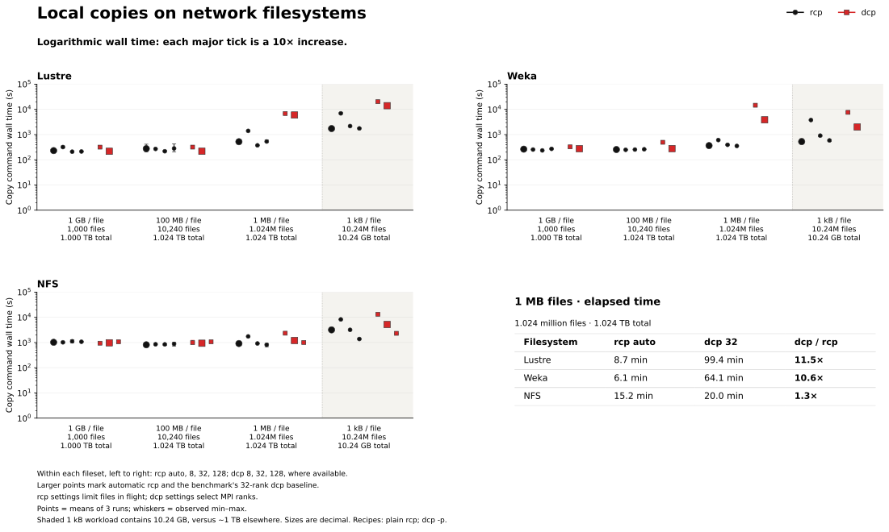
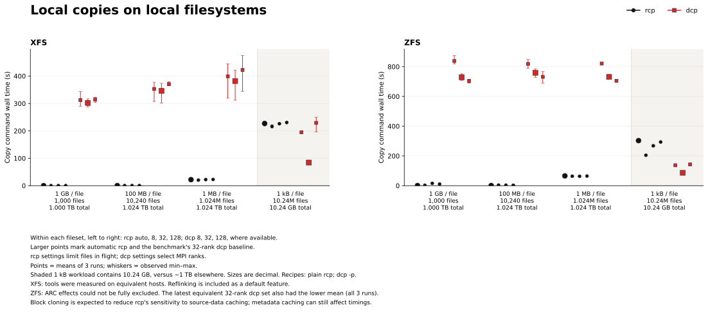
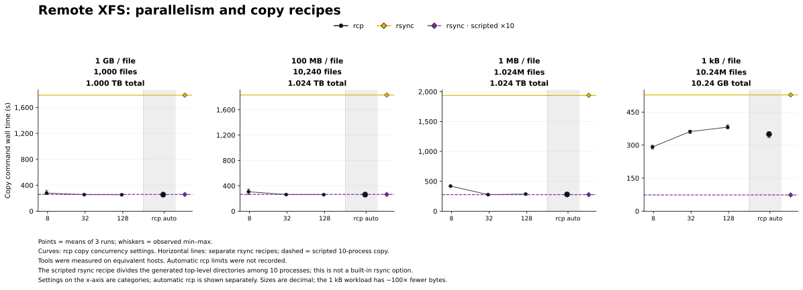
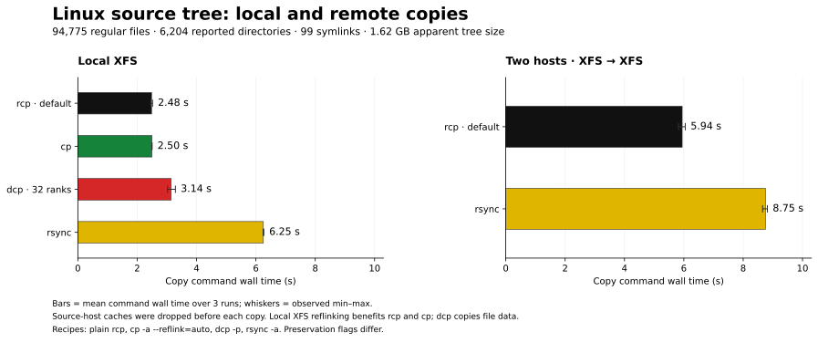
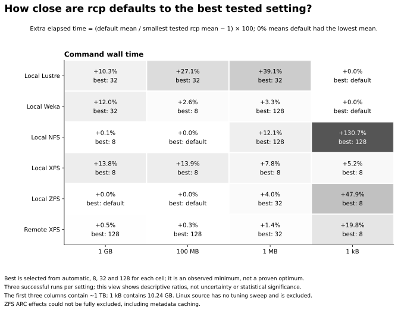
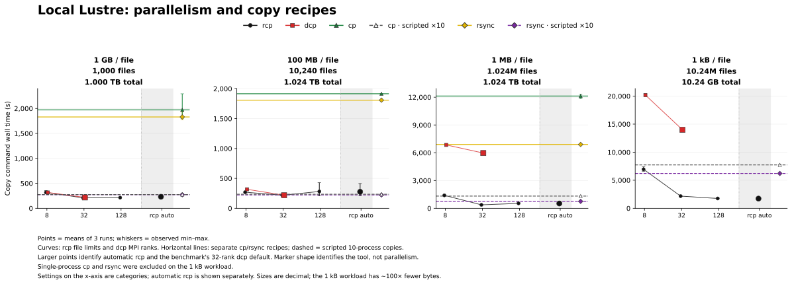
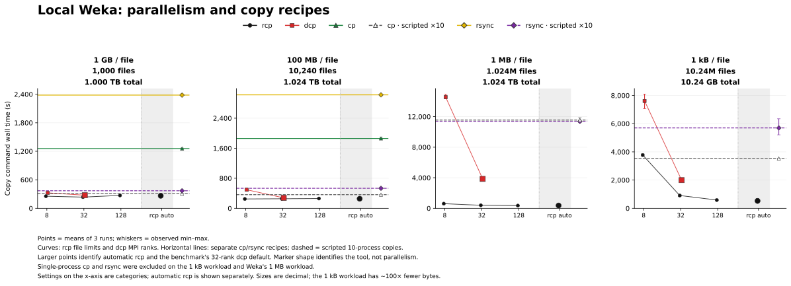
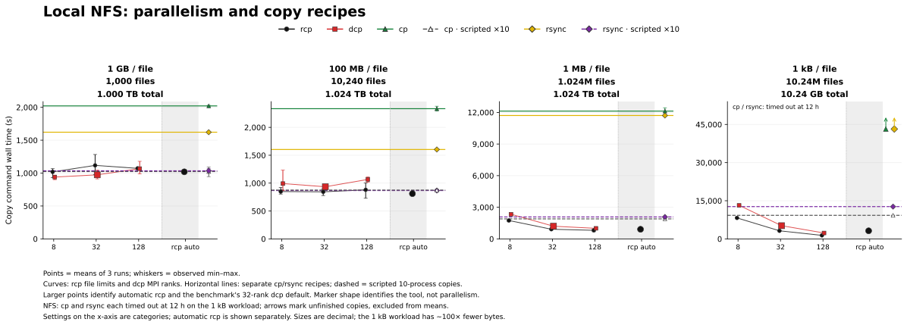
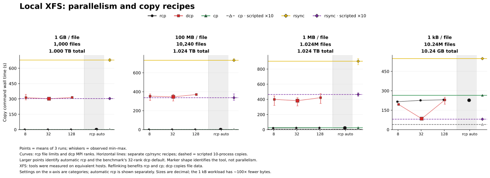
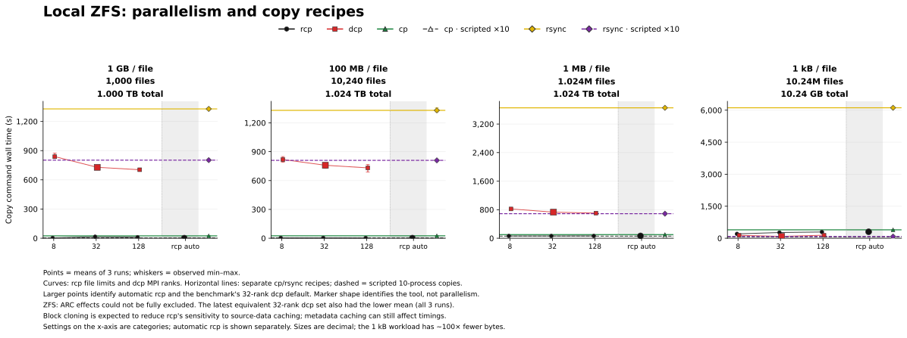

# rcp performance across shared filesystems and everyday copies

## Abstract

We evaluate rcp on local copies across Lustre, Weka, NFS, XFS, and ZFS, on transfers between hosts,
and on a Linux source tree. The generated workloads span 1,000 large files to 10.24 million small
files. For the 1 MB fileset, default rcp takes 8.7 minutes versus 99.4 minutes for 32-rank dcp on
Lustre, and 6.1 versus 64.1 minutes on Weka: dcp takes 11.5 and 10.6 times as long, respectively.
For remote copies of the roughly 1 TB workloads, default rcp is about seven times faster than a
single rsync process and close to a scripted ten-process rsync copy. On the Linux source tree, local
rcp and cp both take about 2.5 seconds; remote rcp takes 5.94 seconds compared with rsync's 8.75
seconds. Across the 24 generated-workload scenarios, rcp defaults are within 20% of its best tested
mean time in 20 cases. We also identify workloads where tuning, dcp, or a scripted copy performs
better, particularly trees of very small files.

## 1 Introduction

Copying a directory can mean moving a terabyte of large files, recreating millions of small files on
shared storage, or transferring a source checkout to another machine. These operations stress
different parts of a system. For an HPC administrator, SRE, or developer, the comparison involves
both elapsed copy time and the configuration used to obtain it.

This report compares rcp with GNU cp, rsync, and MPI-based dcp. It asks three questions: how rcp
performs across filesystems, how its times compare on ordinary local and remote copies, and how
closely its automatic settings approach the best settings tested here. We use command wall time
throughout, so the results describe how long the user waits for the copy command to return.

The comparisons include elapsed times as well as ratios. A difference of roughly a minute and a
difference of more than an hour remain distinct even when both fit within one logarithmic plot.

## 2 Experimental setup

### Workloads and systems

The four generated filesets separate large-file copying from workloads with many filesystem entries.
Each has a uniform file size, allowing these characteristics to be examined separately. Real
datasets commonly mix large and small files, so a single uniform fileset does not represent their
full size distribution. All sizes in this report are decimal: 1 kB is 1,000 bytes, and 1 TB is 10¹²
bytes.

| File size | Regular files | Directories including root | Total file bytes |
| --------- | ------------: | -------------------------: | ---------------: |
| 1 GB      |         1,000 |                         11 |         1.000 TB |
| 100 MB    |        10,240 |                         11 |         1.024 TB |
| 1 MB      |     1,024,000 |                      1,111 |         1.024 TB |
| 1 kB      |    10,240,000 |                     11,111 |         10.24 GB |

*Table 1. Generated filesets. Total file bytes exclude directory metadata.*

The 1 kB workload contains about 100 times fewer bytes than the other generated workloads. It is
shown separately within the figures and should be read as a many-file workload, rather than the next
point in a fixed-volume throughput test.

The application workload is a Linux source tree identified in the benchmark manifest as Linux 7.2.9:
94,775 regular files, 6,204 reported directories, 99 symlinks, and approximately 1.62 GB of apparent
tree size. It provides a less uniform directory structure and a mixture of file sizes.

“Local” means that one host runs the copy against its mounted filesystems. That includes
network-backed Lustre, Weka, and NFS. “Remote” means a transfer between separate hosts, with XFS
storage at both ends.

| Setting         | Source and destination                                    | Compute resources recorded                              |
| --------------- | --------------------------------------------------------- | ------------------------------------------------------- |
| Lustre and Weka | Same respective shared filesystem, accessed from one host | 91 CPUs in affinity; no dedicated benchmark cgroup      |
| NFS             | Same NFS mount on a compute host                          | 32 CPUs and 200G memory requested                       |
| XFS local       | Same host's local instance storage                        | 32 CPUs and 200G memory requested or allocated          |
| ZFS             | Same dataset/device on the filer                          | CPU allocation and instance type not recorded           |
| XFS remote      | Local instance storage on two separate compute hosts      | 32 CPUs and 200G memory requested or allocated per host |

*Table 2. Test settings. Resource requests and affinity counts describe different allocation
mechanisms; the filesystem tests are not hardware-normalized.*

The local XFS and remote generated-workload comparisons use equivalent compute hosts. Hardware and
storage differ between filesystem settings, so the filesystem comparisons should not be read as a
controlled ranking of storage products.

### Tools and copy recipes

Each copy creates a fresh destination tree. The recipes are:

| Label                | Command or configuration                                                                |
| -------------------- | --------------------------------------------------------------------------------------- |
| rcp auto             | rcp with automatic concurrency settings                                                 |
| rcp 8, 32, or 128    | Explicit copy concurrency of N; exact local and remote options are listed in Appendix B |
| dcp 8, 32, or 128    | `mpirun -np N dcp -p`; launcher options are retained in the raw records                 |
| cp                   | One `cp --reflink=auto -a` process                                                      |
| cp · scripted ×10    | Ten concurrent cp processes, one per generated top-level directory                      |
| rsync                | One `rsync -a` process                                                                  |
| rsync · scripted ×10 | Ten concurrent rsync processes, using the same directory partitioning                   |

*Table 3. Tested copy recipes. Explicit settings are 8, 32, and 128 where available.*

The larger dcp marker denotes the benchmark's **32-rank baseline**, not an intrinsic dcp default.
The scripted cp and rsync recipes are separate baselines: neither tool has acquired a native ten-way
parallelism option. The generated directory structure makes this partitioning unusually
straightforward and well balanced.

Default rcp means its performance controls were left automatic. Remote invocations also specify the
daemon binary and a connection timeout; the generated remote runs request runtime summaries. The
archive does not record the effective automatic concurrency limits. The rcp concurrency settings and
dcp MPI rank counts are different controls, even when the numeric labels match.

### Measurement and interpretation

Each successful configuration has three repetitions. Figures show the arithmetic mean with observed
minimum-to-maximum whiskers. These whiskers describe the samples; they are not confidence intervals.
Ratios use unrounded mean command wall times. “Faster by a factor of x” means the comparator's mean
time divided by rcp's mean time.

The summary tables give mean wall time, user and system CPU time, and peak resident memory (RSS) for
the default/baseline comparisons. CPU time is split into user and system time; their sum is the
accounted CPU time. RSS is the mean of the three per-run peaks, in MiB. CPU and memory come from GNU
`time -v` around the local command. They do not consistently cover MPI ranks or remote workers and
are not whole-job resource totals. The [complete results](performance-results.md) give every tested
setting, observed ranges, additional timings, and a
[resource-accounting guide](performance-results.md#resource-accounting). The
[JSON analysis](../../analysis/2026-10-11/analysis.json) retains full precision and individual runs.

Timing includes command startup, MPI launch where applicable, and command completion. Source
staging, destination cleanup, cache preparation, and the subsequent destination sync and validation
are outside the reported command time. The latter measurements remain in the analysis data, but the
figures here answer the command-latency question, not the time to confirmed durable storage.

Before each attempt, the harness synchronizes outstanding writes and requests source-cache eviction.
Lustre, Weka, and ZFS use per-file `POSIX_FADV_DONTNEED`; the compute-host tests use `drop_caches=3`
followed by a five-second wait. Storage-server caches are not controlled. The ZFS qualification is
discussed with its results below.

Equivalent duplicate measurements are resolved by retaining one set of three repetitions. In the
generated workloads, the labels for default dcp and explicit 32-rank dcp describe the same command
configuration and are combined accordingly. The resulting analysis contains 702 successful copies
across 234 configurations, plus two NFS attempts that timed out at 12 hours. Timeouts are shown as
unfinished copies at the limit and do not enter means.

## 3 Local copies

Figures 1 and 2 compare rcp and dcp on network and local filesystems, respectively. The cp and rsync
recipes are included in the detailed local figures in Appendix A. Both groups describe copies
performed by one host against its mounted filesystems.

### Network filesystems



*Figure 1. Local copies on network filesystems. All three panels use the same base-10 logarithmic
time scale: each major tick represents a tenfold increase. The accompanying table gives elapsed
times in minutes for the 1 MB fileset. Within each fileset, rcp settings appear as automatic, 8, 32,
and 128; dcp settings appear as 8, 32, and 128 where available. Larger markers identify automatic
rcp and the 32-rank dcp baseline. The shaded 1 kB fileset has a smaller total byte count.*

**Lustre and Weka.** For the 1.024-million-file workload, default rcp takes **8.7 minutes on Lustre
versus 99.4 minutes for 32-rank dcp**, an 11.5× difference. On Weka, the corresponding times are
**6.1 and 64.1 minutes**, or 10.6×. The differences in elapsed time are about 91 minutes on Lustre
and 58 minutes on Weka. For 10.24 million 1 kB files, default rcp takes 1,728 seconds on Lustre and
524 seconds on Weka, compared with 13,988 and 1,994 seconds for dcp: 8.1× and 3.8× differences,
respectively.

For the larger-file workloads, the tools are closer. On Lustre, default rcp takes 231 seconds for
the 1 GB fileset versus dcp's 217 seconds, and 277 seconds for the 100 MB fileset versus 218
seconds. Setting rcp's file limit to 32 brings those times to 209 and 218 seconds. On Weka,
automatic rcp takes 264 and 255 seconds, compared with dcp's 275 and 277 seconds. The difference on
Lustre's 100 MB workload is about one minute, compared with about 91 minutes on its 1 MB workload.
Reporting the elapsed times alongside the ratios makes that difference in scale explicit.

**NFS.** For the 1 GB and 100 MB filesets, default rcp takes 1,019 and 811 seconds, compared with
974 and 935 seconds for 32-rank dcp. For 1 MB files, default rcp takes 911 seconds versus 1,202
seconds for 32-rank dcp. For 1 kB files, default rcp takes 3,177 seconds versus 5,190 seconds.
Increasing the setting to 128 gives 2,314 seconds for dcp and 1,377 seconds for rcp.

Serial cp and rsync each fail to finish that NFS workload within 12 hours. Their completion times
are unknown beyond the limit. Default rcp finishes in about 53 minutes, and the 128-file setting
finishes in about 23 minutes. The timeout arrows in the detailed NFS figure preserve that
distinction.

The following summaries compare automatic rcp and 32-rank dcp. CPU and peak RSS retain the GNU-time
scope; aggregate resource accounting for dcp's MPI ranks was not validated.

[//]: # (BEGIN GENERATED: network-summary)

#### Local Lustre summary

| File size | Recipe         | Wall time (s) | CPU user (s) | CPU system (s) | Peak RSS (MiB) |
| --------- | -------------- | ------------: | -----------: | -------------: | -------------: |
| 1 GB      | rcp auto       |       230.589 |        0.337 |      1,996.517 |            7.2 |
| 1 GB      | dcp · 32 ranks |       217.206 |      636.447 |        938.587 |           22.8 |
| 100 MB    | rcp auto       |       276.820 |        1.977 |      5,715.320 |            5.8 |
| 100 MB    | dcp · 32 ranks |       218.431 |      335.010 |        950.247 |           23.2 |
| 1 MB      | rcp auto       |       519.931 |      121.187 |     22,540.207 |           95.0 |
| 1 MB      | dcp · 32 ranks |     5,966.359 |    2,325.883 |      5,631.580 |           48.7 |
| 1 kB      | rcp auto       |     1,728.462 |      915.603 |      7,952.560 |        1,075.4 |
| 1 kB      | dcp · 32 ranks |    13,987.649 |    6,773.630 |      6,871.570 |          379.1 |

#### Local Weka summary

| File size | Recipe         | Wall time (s) | CPU user (s) | CPU system (s) | Peak RSS (MiB) |
| --------- | -------------- | ------------: | -----------: | -------------: | -------------: |
| 1 GB      | rcp auto       |       263.638 |        0.240 |        511.907 |            4.5 |
| 1 GB      | dcp · 32 ranks |       274.983 |      525.943 |        619.743 |           22.5 |
| 100 MB    | rcp auto       |       254.777 |        1.953 |        551.437 |            4.2 |
| 100 MB    | dcp · 32 ranks |       277.223 |      173.533 |        748.150 |           22.3 |
| 1 MB      | rcp auto       |       364.740 |       96.627 |        786.020 |           94.5 |
| 1 MB      | dcp · 32 ranks |     3,848.908 |    5,196.713 |        808.597 |           79.0 |
| 1 kB      | rcp auto       |       523.630 |      965.390 |      4,209.060 |        1,070.2 |
| 1 kB      | dcp · 32 ranks |     1,994.002 |    4,295.377 |      1,747.790 |          422.2 |

#### Local NFS summary

| File size | Recipe         | Wall time (s) | CPU user (s) | CPU system (s) | Peak RSS (MiB) |
| --------- | -------------- | ------------: | -----------: | -------------: | -------------: |
| 1 GB      | rcp auto       |     1,019.296 |        0.170 |        212.167 |            9.5 |
| 1 GB      | dcp · 32 ranks |       973.904 |        0.013 |          0.020 |            8.8 |
| 100 MB    | rcp auto       |       811.021 |        1.260 |        224.973 |            9.5 |
| 100 MB    | dcp · 32 ranks |       935.166 |        0.010 |          0.030 |            8.8 |
| 1 MB      | rcp auto       |       910.920 |       64.703 |        431.903 |          129.1 |
| 1 MB      | dcp · 32 ranks |     1,201.788 |        0.013 |          0.027 |            8.8 |
| 1 kB      | rcp auto       |     3,176.639 |      567.037 |      1,800.657 |        1,121.0 |
| 1 kB      | dcp · 32 ranks |     5,189.635 |        0.030 |          0.037 |            8.4 |

[//]: # (END GENERATED: network-summary)

All values are means over three copies.
[All tools and settings](performance-results.md#local-lustre) include the scripted recipes and NFS
timeouts.

### Local filesystems



*Figure 2. Local copies on XFS and ZFS. Settings and default markers follow Figure 1. Filesystem
cloning is included in the copy behavior; the ZFS ARC qualification is discussed below. The shaded 1
kB fileset has a smaller total byte count.*

Filesystem cloning changes the work performed during a local copy. On the tested XFS filesystem,
both rcp and cp use reflinking, while dcp copies file data. This is an intended part of their
default behavior: a user receives an independent copy whose data extents can initially be shared.
Dividing apparent bytes by that time does not measure physical device bandwidth. rcp's
[local copy path](../../README.md#local-copy-acceleration---reflink) requests filesystem assistance
through `copy_file_range`.

For example, default rcp copies the 1 TB XFS workload of 1 GB files in 0.184 seconds, versus 302
seconds for dcp. GNU cp takes 0.071 seconds. These times include the filesystem's copy facilities
and each tool's command overhead.

On ZFS, default rcp takes 0.860 seconds for the 1 GB fileset and 1.116 seconds for the 100 MB
fileset, versus 729 and 759 seconds for 32-rank dcp. ZFS's reflink equivalent is block cloning,
which shares existing data blocks. When cloning succeeds, rcp avoids reading and duplicating the
file payload. This explains why we expect less sensitivity to source-data caching for rcp's cloning
path.
[OpenZFS block cloning documentation](https://openzfs.github.io/openzfs-docs/Basic%20Concepts/Data%20Storage/Block%20Cloning.html).

**ZFS cache caveat.** We could not fully eliminate ARC effects from these measurements. For each ZFS
fileset, we retain the latest of the two equivalent 32-rank dcp trial sets, including all three
repetitions; that set also had the lower mean command wall time. Block cloning is expected to reduce
rcp's sensitivity to source-data ARC state, but metadata caching can still affect its time. Cache
effects were not isolated experimentally.
[OpenZFS caching documentation](https://openzfs.github.io/openzfs-docs/Basic%20Concepts/Pool%20Structure/Caching.html).

These summaries include filesystem-assisted copying. CPU and peak RSS retain the GNU-time scope;
aggregate resource accounting for dcp's MPI ranks was not validated.

[//]: # (BEGIN GENERATED: local-summary)

#### Local XFS summary

| File size | Recipe         | Wall time (s) | CPU user (s) | CPU system (s) | Peak RSS (MiB) |
| --------- | -------------- | ------------: | -----------: | -------------: | -------------: |
| 1 GB      | rcp auto       |         0.184 |        0.067 |          0.147 |            9.5 |
| 1 GB      | dcp · 32 ranks |       302.162 |        0.010 |          0.020 |            8.6 |
| 100 MB    | rcp auto       |         0.372 |        0.680 |          1.207 |            8.2 |
| 100 MB    | dcp · 32 ranks |       346.086 |        0.010 |          0.023 |            8.7 |
| 1 MB      | rcp auto       |        22.001 |       68.200 |        161.493 |           87.2 |
| 1 MB      | dcp · 32 ranks |       381.995 |        0.010 |          0.020 |            8.8 |
| 1 kB      | rcp auto       |       227.009 |      736.277 |      1,783.810 |          747.7 |
| 1 kB      | dcp · 32 ranks |        84.537 |        0.010 |          0.020 |            8.5 |

#### Local ZFS summary

| File size | Recipe         | Wall time (s) | CPU user (s) | CPU system (s) | Peak RSS (MiB) |
| --------- | -------------- | ------------: | -----------: | -------------: | -------------: |
| 1 GB      | rcp auto       |         0.860 |        0.040 |         41.077 |            7.5 |
| 1 GB      | dcp · 32 ranks |       728.596 |      203.483 |        677.053 |           27.0 |
| 100 MB    | rcp auto       |         1.116 |        0.443 |         48.297 |            7.5 |
| 100 MB    | dcp · 32 ranks |       758.931 |       63.097 |        679.710 |           27.7 |
| 1 MB      | rcp auto       |        65.899 |       78.610 |        927.123 |          112.7 |
| 1 MB      | dcp · 32 ranks |       731.086 |      104.043 |        739.250 |           61.8 |
| 1 kB      | rcp auto       |       303.003 |      767.103 |     14,322.783 |        1,092.9 |
| 1 kB      | dcp · 32 ranks |        86.816 |      450.753 |      1,907.227 |          415.6 |

[//]: # (END GENERATED: local-summary)

All values are means over three copies. [All tools and settings](performance-results.md#local-xfs)
include cp, rsync, and the scripted recipes.

### Generated filesets and scripted copies

The cp and rsync results compare single-process copies with scripts that partition the source tree.
On Lustre's 1 MB fileset, default rcp takes 520 seconds, compared with 12,127 seconds for serial cp
and 6,895 seconds for serial rsync. Dividing the tree among ten processes reduces these to 1,317 and
748 seconds. On Weka's same fileset, default rcp takes 365 seconds, compared with 11,550 seconds for
scripted cp and 11,370 seconds for scripted rsync.

XFS gives a different answer. The table below includes the ordinary commands and the scripted
recipes, with mean command wall time in seconds.

| File size | rcp auto | dcp 32 ranks |    cp | cp · ×10 | rsync | rsync · ×10 |
| --------- | -------: | -----------: | ----: | -------: | ----: | ----------: |
| 1 GB      |    0.184 |        302.2 | 0.071 |    0.053 | 679.9 |       304.1 |
| 100 MB    |    0.372 |        346.1 | 0.276 |    0.082 | 731.9 |       336.8 |
| 1 MB      |     22.0 |        382.0 |  25.0 |      4.0 | 903.4 |       464.4 |
| 1 kB      |    227.0 |         84.5 | 264.9 |     39.8 | 548.7 |        80.6 |

*Table 4. XFS local copies. The ×10 columns are scripted recipes using the generated tree's ten
top-level directories. They are not tool concurrency flags.*

For 1 MB and 1 kB files, default rcp takes less time than serial cp, while the ten-process cp recipe
takes less time than either. On the 1 kB workload, dcp and scripted rsync also take less time than
default rcp. ZFS shows a similar small-file reversal: default rcp takes 303 seconds, versus 87
seconds for 32-rank dcp and 65 seconds for scripted cp. Cloning removes much of the payload-copy
work; it does not remove the work of creating millions of files.

The generated trees have ten balanced, independent top-level subtrees. The scripted recipes use that
partition, while the rcp measurements use one invocation without manual partitioning. A mixed-size
tree with uneven subtrees is a different workload from the generated cases measured here.

## 4 Remote copies

Remote copies transfer the generated filesets between XFS filesystems on separate hosts. They
therefore exercise data transfer between machines rather than local extent sharing. Figure 3
compares rcp's automatic and explicit settings with single-process and scripted rsync.



*Figure 3. Remote generated workloads on equivalent hosts. Numeric rcp settings select the tested
copy concurrency limits; automatic rcp is shown separately. Horizontal lines represent
single-process rsync and the scripted ten-process recipe.*

For the three workloads of roughly 1 TB, automatic rcp takes 255, 262, and 281 seconds as file size
decreases from 1 GB to 100 MB to 1 MB. Single-process rsync takes 1,790, 1,832, and 1,938 seconds:
approximately seven times as long. The scripted ten-process rsync recipe takes 259, 265, and 277
seconds. On these workloads, default rcp is within about 1.4% of that scripted recipe's mean time,
without requiring a partition of the source tree.

The automatic setting is within 1.5% of the fastest tested rcp mean in all three cases. Increasing
parallelism is not uniformly beneficial: the 128 setting is fastest for the two larger-file sets,
while 32 is fastest for the 1 MB set.

The 10.24-million-file workload is an exception. Default rcp takes 349 seconds versus 528 seconds
for serial rsync, but scripted rsync takes 74 seconds. Reducing rcp copy concurrency to 8 reduces
its time to 292 seconds.

The table summarizes the automatic rcp and rsync recipes. **CPU and RSS cover the timed local
command only:** rcp's numbers largely describe the master CLI, while rsync excludes its remote
receiver. These are not measurements of the complete transfer's resource use.

[//]: # (BEGIN GENERATED: remote-summary)

| File size | Recipe               | Wall time (s) | CPU user (s) | CPU system (s) | Peak RSS (MiB) |
| --------- | -------------------- | ------------: | -----------: | -------------: | -------------: |
| 1 GB      | rcp auto             |       255.370 |        0.057 |          0.013 |            9.1 |
| 1 GB      | rsync                |     1,789.548 |    2,003.453 |        502.350 |           16.2 |
| 1 GB      | rsync · scripted ×10 |       258.607 |    1,961.753 |        560.743 |           16.2 |
| 100 MB    | rcp auto             |       261.856 |        0.050 |          0.020 |            9.7 |
| 100 MB    | rsync                |     1,832.147 |    2,039.697 |        477.443 |           16.1 |
| 100 MB    | rsync · scripted ×10 |       264.740 |    2,012.683 |        572.687 |           16.3 |
| 1 MB      | rcp auto             |       281.060 |        0.050 |          0.020 |            9.1 |
| 1 MB      | rsync                |     1,937.598 |    2,046.920 |        500.477 |           14.2 |
| 1 MB      | rsync · scripted ×10 |       277.290 |    2,026.500 |        576.663 |           14.3 |
| 1 kB      | rcp auto             |       349.452 |        0.057 |          0.013 |            9.6 |
| 1 kB      | rsync                |       527.710 |       41.410 |         66.630 |           10.6 |
| 1 kB      | rsync · scripted ×10 |        73.788 |       41.580 |         69.467 |           10.6 |

[//]: # (END GENERATED: remote-summary)

All values are means over three copies. Separate
[rcp master, source, and destination measurements](performance-results.md#remote-rcp-role-measurements)
are available for these generated workloads, alongside
[every tested setting](performance-results.md#remote-xfs).

## 5 Linux source tree

The Linux tree tests the everyday-copy part of the comparison. It has much less data than the large
generated workloads, a less regular hierarchy, and no manually partitioned recipes. The local test
compares default rcp, 32-rank dcp, serial cp, and serial rsync. The remote test compares default rcp
with serial rsync on a physical pair of hosts.



*Figure 4. Linux source tree copies. Bars show mean command wall time over three repetitions;
whiskers show the observed range. The local and remote panels report separate copy operations.*

The table gives means over three copies. Remote resource values cover the timed local command only;
rcp's remote row largely describes its master CLI. Separate daemon measurements were not recorded
for this tree. Dcp's aggregate MPI resource use was not validated.

[//]: # (BEGIN GENERATED: linux-summary)

| Scope  | Recipe         | Wall time (s) | CPU user (s) | CPU system (s) | Peak RSS (MiB) |
| ------ | -------------- | ------------: | -----------: | -------------: | -------------: |
| Local  | rcp auto       |         2.484 |        6.457 |         20.150 |          160.1 |
| Local  | dcp · 32 ranks |         3.144 |        0.010 |          0.020 |            8.5 |
| Local  | cp             |         2.497 |        0.113 |          1.733 |            3.0 |
| Local  | rsync          |         6.251 |        0.667 |          3.247 |           11.3 |
| Remote | rcp auto       |         5.945 |        0.060 |          0.010 |            9.9 |
| Remote | rsync          |         8.749 |        3.487 |          1.453 |           13.8 |

[//]: # (END GENERATED: linux-summary)

[Complete Linux-source results with observed ranges](performance-results.md#linux-source).

### Local copies

Local rcp takes 2.484 seconds and cp takes 2.497 seconds, a difference of 0.013 seconds. Their
observed ranges overlap. Dcp takes 3.144 seconds and rsync takes 6.251 seconds. The rcp mean is
about 40% of the serial rsync mean on this tree.

Reflinking remains part of the XFS result for rcp and cp. Command startup and tree handling are
included in the measured command time.

### Remote copies

Remote rcp takes 5.945 seconds, compared with 8.749 seconds for rsync. That is 32% less elapsed
time, or a 1.47× speedup. The observed ranges are 5.819–6.049 seconds for rcp and 8.655–8.816
seconds for rsync. No concurrency tuning was applied to rcp in this comparison.

The source-tree measurements cover a mixture of file sizes and a less regular hierarchy than the
generated workloads. At approximately 1.62 GB, this tree is also much smaller than the roughly 1 TB
generated sets. It does not establish performance for a large dataset with a different mixture of
file sizes.

## 6 How well the defaults work

Figure 5 compares automatic rcp with its own best tested setting in each generated-workload
scenario. The value is extra time relative to the smallest observed mean:

`extra time (%) = 100 × (automatic mean / best tested rcp mean − 1)`



*Figure 5. Cost of using automatic settings. Each cell selects the smallest mean among automatic, 8,
32, and 128 for that scenario. This is a descriptive comparison with the tested settings, not a
claim that the selected setting is a global optimum.*

Across the 20 local and four remote generated-workload scenarios, defaults are within 15% of the
best tested rcp mean in 19 cases, and within 20% in 20 cases. These counts give each scenario equal
weight; they are not a workload-frequency-weighted score. For the three roughly 1 TB remote
workloads, the differences are below 1.5%. Automatic rcp is also the fastest tested setting on
Lustre and Weka for the 10.24-million-file workload.

Four cases have more than 20% extra time. On Lustre, a limit of 32 reduces the 100 MB workload from
277 to 218 seconds and the 1 MB workload from 520 to 374 seconds; defaults take 27% and 39% longer,
respectively. On NFS, a limit of 128 reduces the 1 kB workload from 3,177 to 1,377 seconds; the
default takes 131% longer. On ZFS, reducing the limit to 8 cuts the 1 kB workload from 303 to 205
seconds; the default takes 48% longer. The best direction of adjustment differs across filesystems.

These percentages describe the difference among rcp settings. They should be read with the elapsed
times: the Lustre 100 MB setting changes the mean by about one minute, while the rcp/dcp comparison
on Lustre's 1 MB workload differs by about 91 minutes. No single explicit concurrency setting has
the lowest rcp mean across all tested scenarios.

## 7 Relating the measurements to other workloads

**File sizes and counts.** The generated filesets isolate uniform sizes. A real tree can contain
both a large payload in a few files and many small files. The measured ratios for the individual
filesets do not establish the ratio for that mixture. The Linux tree supplies one mixed-size
example; a large mixed-size dataset is outside the measured set.

**Elapsed time and ratios.** Both are needed to describe a comparison. The 1 MB Lustre copy takes
8.7 minutes with automatic rcp and 99.4 minutes with 32-rank dcp. The 100 MB Lustre copy takes 4.6
and 3.6 minutes, respectively. The logarithmic overview displays both comparisons, while the listed
durations preserve the difference in time spent copying.

**Copy recipe and filesystem support.** The ten-process recipes assume ten independent, balanced
subtrees. Local XFS and ZFS measurements include filesystem-assisted copying. These conditions are
part of the measured operation and need to be matched when reproducing a result.

**Concurrency.** The sweep compares automatic settings with 8, 32, and 128. Appendix B lists the
exact benchmark options. See the [rcp usage documentation](../../README.md) for current command
syntax and copy semantics.

## 8 Limitations

These are three-repetition measurements on particular hosts and storage installations. They
establish observed command times, not statistical significance, storage-system rankings, or
performance guarantees. Different settings may have different bottlenecks, and the archive does not
provide physical I/O measurements from which to separate them.

Cache preparation is not a guarantee of cold storage. The shared-storage tests leave server caches
uncontrolled; remote destination-cache eviction is not documented; and the ZFS ARC qualification
remains material.

The commands perform fresh tree copies with different preservation flags: plain rcp, dcp `-p`, and
cp/rsync archive modes. In a separate reference check, the regular-file contents and tree layout
matched between rcp and cp, but original modification-time preservation differed. That check used a
different rcp build from the archived benchmarks. These results compare the listed recipes; they do
not establish the cost of identical metadata-preservation policies. Per-copy validation in the
archive checks file counts and apparent sizes rather than full content hashes.

The Linux tree is one representative application workload. The generated trees are deliberately
regular, and the ten-process recipes benefit from that structure. This report covers fresh copies;
it does not evaluate incremental synchronization or resumed transfers. CPU and memory accounting
scopes differ across tools and remote roles. The tables retain those recorded values with explicit
scope qualifications; they do not establish a whole-job resource comparison.

## 9 Conclusion

On the generated 1 MB fileset, 32-rank dcp takes 11.5 times as long as automatic rcp on Lustre and
10.6 times as long on Weka. Using automatic rcp reduces elapsed time by about 91 and 58 minutes,
respectively. The Linux source tree takes 2.484 seconds with local rcp and 2.497 seconds with cp;
remote rcp takes 5.945 seconds compared with rsync's 8.749 seconds. Across the generated scenarios,
automatic rcp is within 20% of its best tested mean in 20 of 24 cases. The 1 kB workloads include
cases where explicit tuning, dcp, or a scripted recipe has a lower mean time than automatic rcp.
These are results for the measured file-size distributions and copy recipes.

## Appendix A Detailed local results

These plots retain all available tools and copy recipes. Curves belong to rcp and dcp; horizontal
lines belong to the separate cp and rsync recipes. Larger points mark automatic rcp and the
benchmark's 32-rank dcp baseline. Whiskers show the observed range over three successful copies. All
plots in this appendix use linear wall-time axes starting at zero.

### Lustre



*Figure A1. Lustre. Serial cp and rsync were excluded on the 1 kB workload. The 128-rank dcp
configuration was omitted under the campaign's resource policy.*

### Weka



*Figure A2. Weka. Serial cp and rsync were excluded on the 1 MB and 1 kB workloads. The 128-rank dcp
configuration was omitted under the campaign's resource policy.*

### NFS



*Figure A3. NFS. The arrows on the 1 kB panel mark the 12-hour limits of unfinished serial cp and
rsync attempts. They are not measured completion times. Subsequent repetitions of those recipes were
omitted.*

### XFS



*Figure A4. XFS. Tools were tested on equivalent compute hosts. Reflinking benefits rcp and cp.*

### ZFS



*Figure A5. ZFS. ARC effects could not be fully excluded. The latest equivalent 32-rank dcp trial
set is retained with all three repetitions and also had the lower mean command wall time. Block
cloning is expected to reduce rcp's sensitivity to source-data caching; metadata caching can still
affect its time.*

## Appendix B Reproducing the analysis

The report and figures derive from `rcp-results-clean-20261011.tar.gz`. The exact analyzed archive
has SHA-256:

```text
507e1cc9c49fd6cd3a1f7db37221828bcebabc17afdf953484d8692943ffcff4
```

The packet contains 762 successful measurements. Resolving equivalent duplicate dcp measurements
supersedes 60 of them, leaving 702 successes in the plotted analysis. The two NFS timeouts are
retained separately. The audit verifies all 64 checksum-listed files, 1,524 embedded log hashes, and
6,064 recorded summary statistics. The expected coverage has 254 complete labeled configurations, 14
documented exclusions, and two timeouts; combining equivalent dcp labels reduces the complete set to
234 configurations.

The principal rcp builds are:

| Measurements                                           | Reported version | Git revision |
| ------------------------------------------------------ | ---------------- | ------------ |
| Lustre and Weka                                        | 0.40.0           | `5a1601f4`   |
| NFS and ZFS                                            | 0.41.0           | `e68a5adf`   |
| Local XFS, remote generated filesets, and Linux source | 0.41.0           | `27c08950`   |

The Lustre/Weka manifest records mpiFileUtils 0.12, Open MPI 5.0.9, GNU coreutils 9.8, and rsync
3.4.1. Version capture is less complete in the other test settings; their exact commands and
available environment evidence are retained in the archive. Full rcp hashes and measurement contexts
are available in [the normalized analysis](../../analysis/2026-10-11/analysis.json).

For the explicit rcp settings, N is 8, 32, or 128. Local copies use `--max-files-in-flight=N`;
remote copies use `--max-files-in-flight=N --max-connections=N`. The remote sweep varies these
limits together, so it does not isolate the effect of either control. Automatic rcp leaves both
options unset. The main text and figures label the explicit settings by N for readability; the
archive retains the full invocation for every sample.

The [preserved measurement packet](../../analysis/2026-10-11/raw/) contains every original file,
including individual repetitions, exact commands, embedded command and timing logs, environment
records, and superseded measurements. Its original `SHA256SUMS` is retained. The
[packet identity](../../analysis/2026-10-11/packet-origin.json) records the source archive hash and
the checksum-manifest hash; the unpacked files are preserved byte for byte.

Regenerate the analysis and figures from the repository root using the preserved packet and the
locked Nix reporting environment:

```bash
nix develop .#reports --command python3 analysis/2026-10-11/analyze.py
nix develop .#reports --command just report-tables
nix develop --command just fmt
```

The reference environment uses Python 3.14.7, NumPy 2.5.2, and Matplotlib 3.11.1. For installation
without Nix, see the [reproduction guide](../../analysis/2026-10-11/README.md) and pinned
[Python requirements](../../analysis/2026-10-11/requirements.txt). Those Python pins alone do not
guarantee byte-identical SVG output across platforms; fonts and native libraries can affect
rendering. The audit requires enabled Python assertions and rejects optimized execution.

The script verifies the archive, recomputes statistics, resolves equivalent configurations, and
writes the ten SVG figures used by this report. The inputs are not modified. It also accepts the
original archive as a positional argument. Optional raster exports can be written outside the
repository with `--png-output /tmp/rcp-figures`. The report embeds only the command-wall-time
figures. The [complete tables](performance-results.md) include supplemental timings; their
[generator](../../analysis/2026-10-11/tables.py) reads the selected JSON statistics directly.

Supporting files include the [analysis and plotting script](../../analysis/2026-10-11/analyze.py),
[ZFS command-stage audit](../../analysis/2026-10-11/zfs-stage-audit.json),
[reference command-semantics check](../../analysis/2026-10-11/semantics-reference.json), and
[archive audit](../../analysis/2026-10-11/archive-update-2026-10-12.json).

## References

1. [rcp usage and local copy acceleration](../../README.md).
2. [rcp benchmarking guidance](../../docs/benchmarking.md).
3. [OpenZFS block cloning](https://openzfs.github.io/openzfs-docs/Basic%20Concepts/Data%20Storage/Block%20Cloning.html).
4. [OpenZFS caching and auxiliary devices](https://openzfs.github.io/openzfs-docs/Basic%20Concepts/Pool%20Structure/Caching.html).
5. [Benchmark measurements, selection policy, and computed comparisons](../../analysis/2026-10-11/analysis.json).
