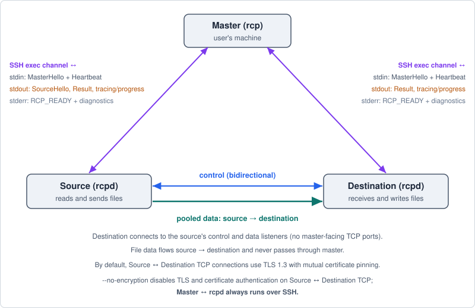

# Remote transport design

The `remote` crate owns SSH bootstrap, TCP/TLS transport, stream framing, and shared protocol types.
It does not own filesystem traversal or destination writes; those live in `rcp`.

For commands, deployment choices, and troubleshooting, start with
[remote copy operations](../docs/remote_copy.md). The
[protocol reference](../docs/remote_protocol.md) remains the detailed specification of messages,
ordering, resource accounting, and shutdown. This page is a component map, not a second
specification.

## Topology

SSH starts, supervises, and carries all master↔daemon control and tracing traffic over each daemon's
framed `stdin`/`stdout` pipes. By default (`--remote-transport=tcp`), the destination opens control
and pooled data TCP connections directly to the source; file contents flow from source to
destination, not through the master. When direct TCP ports are blocked, `--remote-transport=ssh` and
`--remote-transport=auto` tunnel source↔destination traffic over parallel OpenSSH `-L`/`-R` port
forwards (and directly destination→source in 3-host copies, never relaying through the master).
Source↔Destination TCP connections use mutual TLS 1.3 by default. See
[network connectivity](../docs/remote_copy.md#network-connectivity).

## Ownership and lifecycle

1. **Prepare endpoints.** The master validates configuration, discovers compatible binaries, and
   optionally deploys them. Equal SSH sessions share preparation; distinct endpoints can prepare
   concurrently.
2. **Establish roles.** Source readiness (`RCP_READY`) reports its certificate fingerprint when
   encrypted and its resolved file/stream limits on stderr, then switches `stdin`/`stdout` to binary
   framing. The master uses those limits when starting the destination and checks agreement before
   dispatching work.
3. **Transfer.** The master distributes source addresses and fingerprints over SSH `stdin`. The
   source/destination control stream coordinates discovery and admission; reusable data streams
   carry file contents.
4. **Finish and reap.** Wire results are not enough: the master closes daemon `stdin`, waits for
   daemon exits, and drains stdout demux/tracing tasks. Owned SSH children and bootstrap work must
   retain a cleanup owner on cancellation.

Keep these boundaries intact when changing the component:

- Compatibility means the full protocol-version string, not just the release number. See
  [version checking](../docs/remote_copy.md#version-checking).
- Addresses and certificate identity have different roles. Fingerprints are exchanged through SSH;
  TLS pinning does not independently establish that the SSH peer is the intended host. See
  [SSH host-key verification](../docs/security.md#ssh-host-key-verification).
- Connection acceptance, stream framing, and cancellation must preserve message boundaries. Keep
  socket setup in the shared helpers rather than adding unconfigured TCP paths in callers.
- Completion and cleanup are part of the result, not detached background work. See
  [connection lifecycle](../docs/remote_protocol.md#6-connection-lifecycle).

## Where to change what

| Concern                                                          | Implementation                                                            |
| ---------------------------------------------------------------- | ------------------------------------------------------------------------- |
| SSH sessions, readiness, cleanup ownership, socket configuration | [`src/lib.rs`](src/lib.rs)                                                |
| Master↔daemon SSH stdio framing, demux, and heartbeats           | [`src/stdio.rs`](src/stdio.rs)                                            |
| OpenSSH mux v4 port forwarding (`-L`/`-R`) and `ssh -G` config   | [`src/ssh_tunnel.rs`](src/ssh_tunnel.rs)                                  |
| Binary deployment                                                | [`src/deploy.rs`](src/deploy.rs)                                          |
| Protocol compatibility and build identity                        | [`src/version.rs`](src/version.rs), [`build.rs`](build.rs)                |
| Serialized messages and daemon configuration                     | [`src/protocol`](src/protocol)                                            |
| Framing and TLS                                                  | [`src/streams.rs`](src/streams.rs), [`src/tls.rs`](src/tls.rs)            |
| Pluggable source↔destination transport seam                      | [`src/transport.rs`](src/transport.rs)                                    |
| Master orchestration and daemon entry point                      | [`rcp`](../rcp/src/bin/rcp.rs), [`rcpd`](../rcp/src/bin/rcpd.rs)          |
| Traversal, admission, and destination writes                     | [`source`](../rcp/src/source), [`destination`](../rcp/src/destination.rs) |

Repository-wide verification guidance belongs in [testing](../docs/testing.md) and measurement
guidance in [benchmarking](../docs/benchmarking.md). Keep test commands and benchmark procedures
there; link implementation-specific invariants to the protocol reference rather than copying them.
